<div align="center">


<br/>

[](https://www.python.org/)
[](https://fastapi.tiangolo.com/)
[](https://playwright.dev/python/)
[](https://crawl4ai.com/)
[-brightgreen?style=for-the-badge&logo=pytest&logoColor=white)](tests/)
[](http://localhost:8000/docs)
[](LICENSE)

<br/>

**Nexora** is an enterprise-grade, asynchronous web crawling, content extraction, and data intelligence platform engineered specifically for **Retrieval-Augmented Generation (RAG)**, LLM knowledge grounding, and production semantic search systems.

[Live Studio Tour](#-live-studio-tour--visual-showcase) •
[Live Extraction Engine](#-live-real-time-extraction--change-tracking) •
[System Pipeline](#-animated-pipeline-architecture) •
[Interactive Terminal](#-animated-developer-cli-experience) •
[4-Engine Comparison](#-4-engine-extraction-matrix) •
[IR Evaluation](#-information-retrieval-ir-evaluation-studio) •
[Interactive API Docs](#-bespoke-interactive-api-documentation-portal) •
[Python SDK & CLI](#-python-sdk--developer-cli) •
[Quickstart](#-quickstart-guide) •
[Production Deployment](#-production-deployment-docker--systemd)

</div>

---

## ⚡ Animated Developer CLI Experience

Experience autonomous multi-depth web discovery, Playwright headless extraction, Persian/multilingual semantic chunking, and IR benchmark evaluation executed directly from the terminal:

<div align="center">
  
</div>

---

## 🔄 Animated Pipeline Architecture

Nexora transforms messy, unstructured, dynamic web pages and multi-format documents into clean, deduplicated, verified semantic chunks ready for production vector databases:

<div align="center">
  
</div>

---

## 📸 Live Studio Tour & Visual Showcase

Nexora features a modern, dark-themed glassmorphic Studio interface (`#0b0f17`) built with responsive desktop controls, real-time job telemetry, and instant visual inspection.

### 1. URL Discovery Studio
Autonomous recursive web crawler with XML sitemap auto-detection, robots.txt parser, regex pattern white/blacklisting, query-string retention, and live page metrics.
<div align="center">
  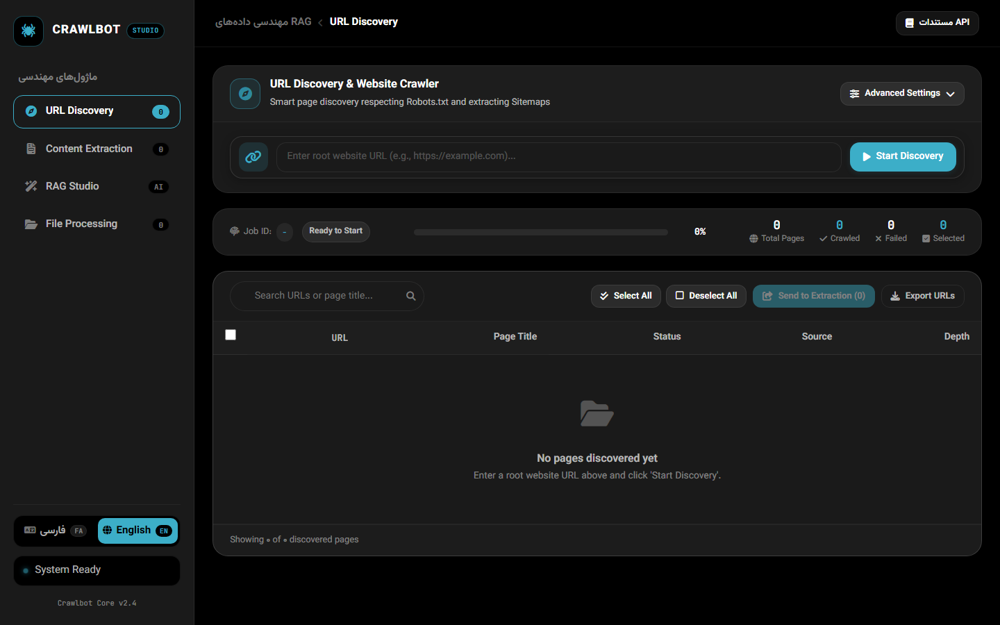
</div>

<br/>

### 2. 4-Engine Content Extraction Studio
Autonomous page classification (Article, Docs, SPA, Product, FAQ) with an intelligent fallback cascade: Smart Auto, Playwright Chromium headless rendering, Crawl4AI, and Trafilatura.
<div align="center">
  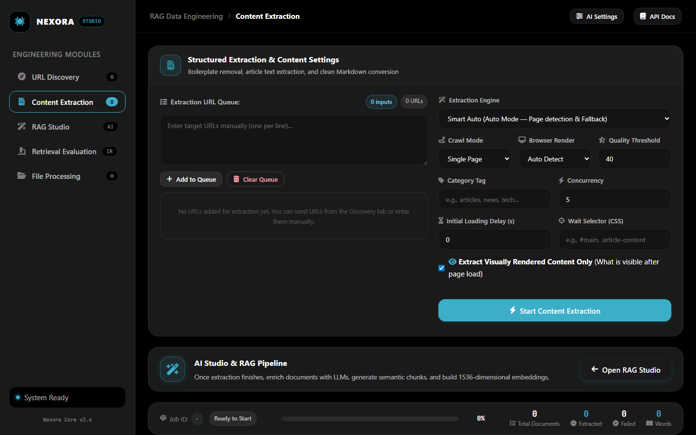
</div>

<br/>

### 3. AI & RAG Structuring Studio
Persian & multilingual unicode normalization, semantic sentence-boundary chunking, automated markdown repair, multi-provider embedding generation (OpenAI, Gemini, Local), and hybrid dense search.
<div align="center">
  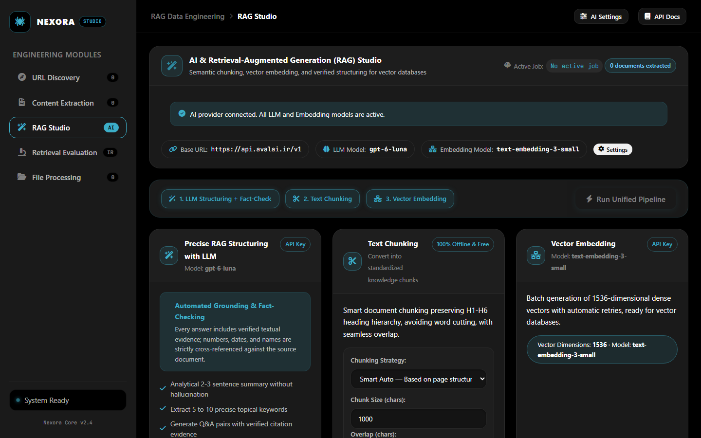
</div>

<br/>

### 4. Information Retrieval (IR) Evaluation Studio
Scientific retrieval benchmark laboratory computing Recall@K, MRR, and nDCG@K. Compare 3 algorithmic methods (Dense vs BM25 vs Hybrid) and inspect candidate exclusions with step-by-step pipeline tracing.
<div align="center">
  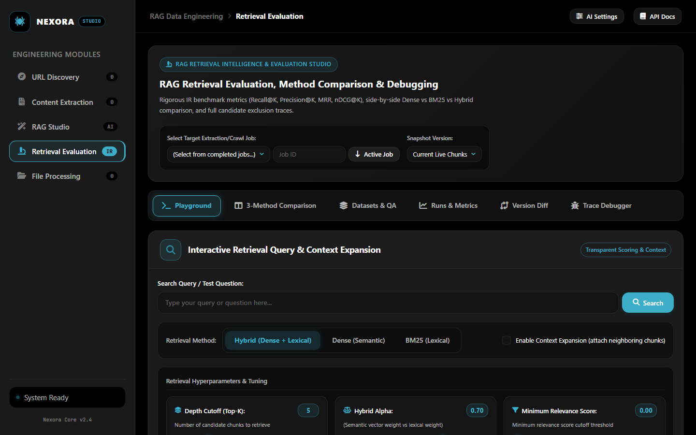
</div>

<br/>

### 5. Multi-Format File Processing Studio
Ingest PDF, DOCX, TXT, MD, JSON, and CSV documents directly. Automatic text extraction, structural normalization, semantic chunking, and instant vector store indexing.
<div align="center">
  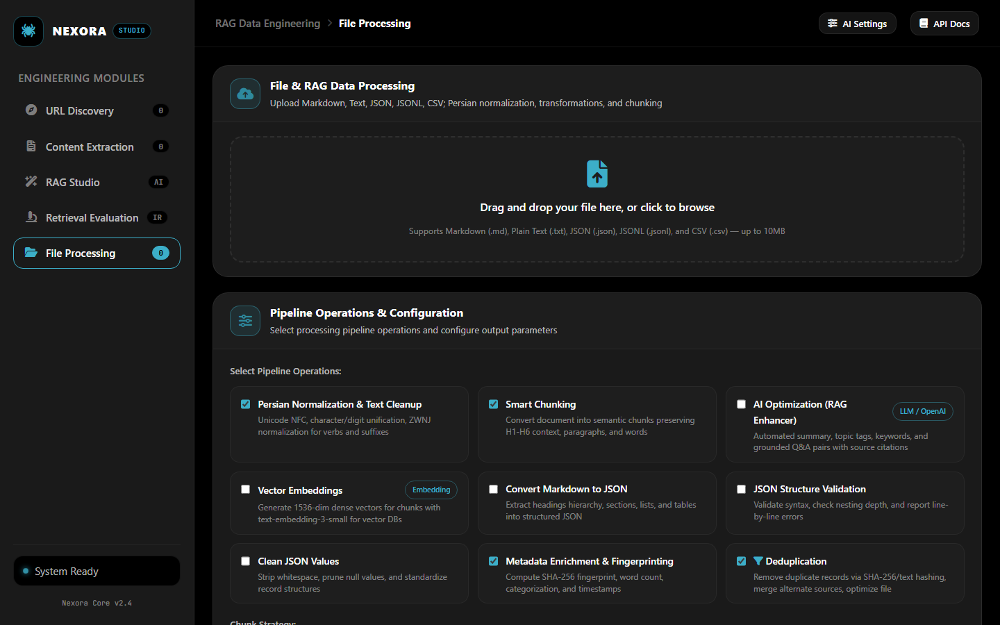
</div>

<br/>

### 6. Live Real-Time Extraction & Change Tracking Studio
Continuous live monitoring of e-commerce prices, financial tickers, stock availability, and dynamic APIs. Automatically tracks DOM mutations, replaces previous stale data with the latest state, and emits live SSE streams.
<div align="center">
  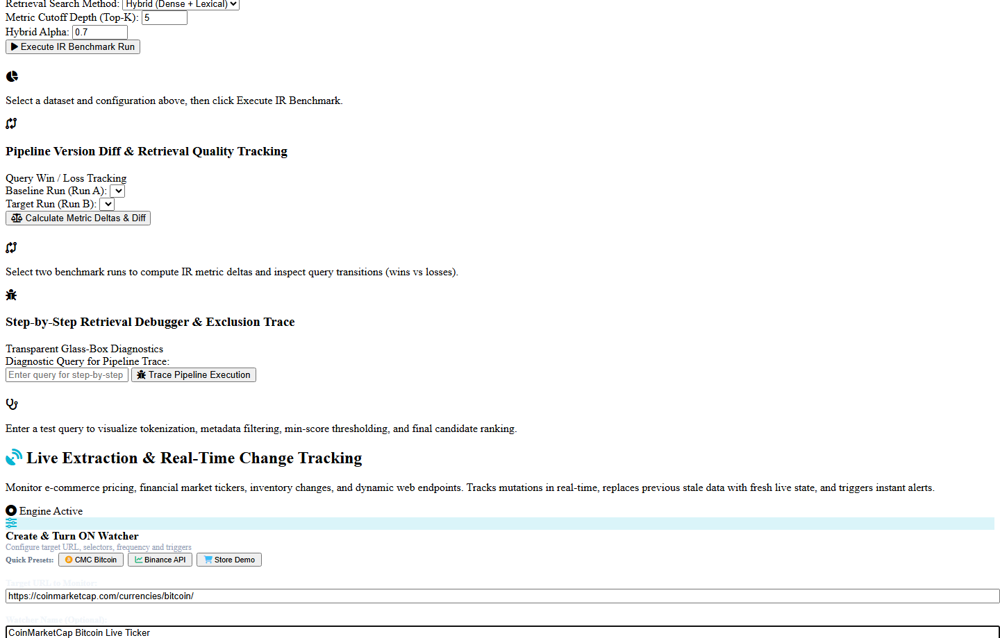
</div>

<br/>

### 7. AI Settings & Bring-Your-Own-Key (BYOK) Management
Configure your AI providers (OpenAI, Google Gemini, Ollama, DeepSeek) directly from the Studio. Secure secret encryption, custom Base URLs, and model selection.
<div align="center">
  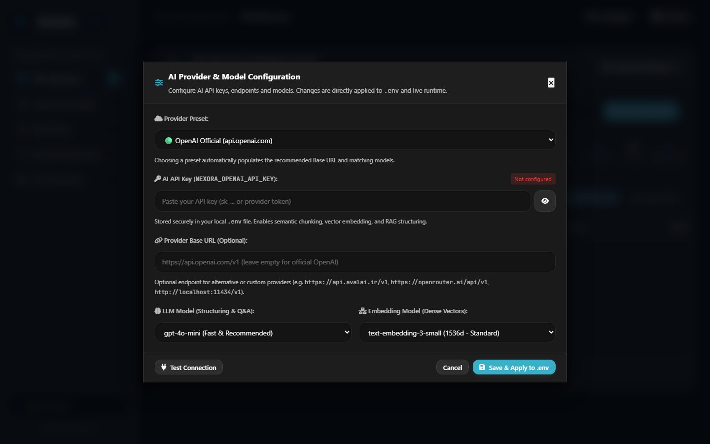
</div>

---

## 🐍 Official Python SDK Interactive Documentation Portal (`/sdk`)

In addition to the REST API reference, Nexora provides a dedicated, dark-themed interactive documentation portal for the **Python SDK** hosted at `/sdk` (and `/sdk-docs`), accompanied by a complete Markdown manual in `docs/PYTHON_SDK.md`:

<div align="center">
  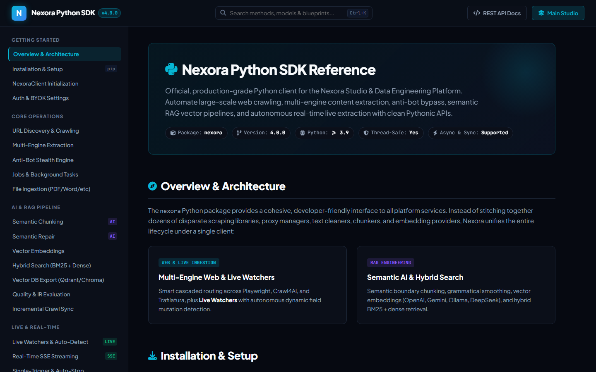
</div>

### Python SDK Portal Features:
- **Exhaustive API Reference**: Covers client initialization, multi-engine crawling, anti-bot stealth, file ingestion, semantic chunking, hybrid search, and live watchers.
- **One-Click Code Copy**: Copy snippets directly with automatic clipboard feedback.
- **Interactive Search (`Ctrl + K`)**: Real-time fuzzy filtering of SDK methods and models.
- **4 Complete Production Blueprints**: Ready-to-run scripts for Crypto Arbitrage, Enterprise RAG, Competitor Pricing, and Flash Sale Sniping.

---

## 📖 Bespoke Interactive API Documentation Portal

Rather than relying on generic Swagger UI, Nexora includes a custom-designed, dark-themed developer documentation portal hosted at `/docs` (and aliased at `/api-docs`):

<div align="center">
  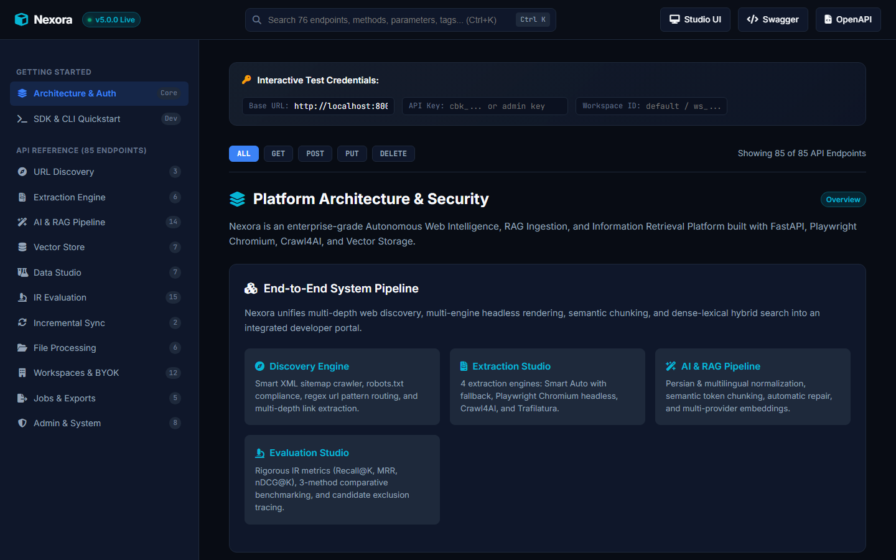
</div>

<br/>

<div align="center">
  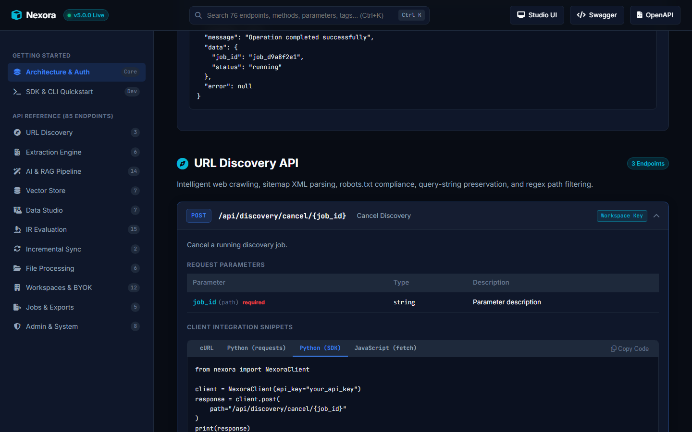
</div>

### Key API Portal Highlights:
- **Complete Endpoint Coverage**: All **95 platform endpoints** categorized across 12 distinct functional modules.
- **Instant Search (`Ctrl + K`)**: Real-time fuzzy filtering across paths, summaries, HTTP methods, and parameter schemas.
- **Method Filter Pills**: Instant one-click filtering by `ALL`, `GET`, `POST`, `PUT`, `DELETE`.
- **4-Language Code Generator**: Copy-paste ready snippets in **cURL**, **Python (requests)**, **Python (Nexora SDK)**, and **JavaScript (fetch)**.
- **In-Browser "Try It Live" Console**: Test endpoints interactively against your local server with configurable headers, payloads, live status badges, latency timers, and formatted JSON output.

---

---

## ⚡ Live Real-Time Extraction & Change Tracking

For dynamic websites where data changes rapidly—such as **e-commerce pricing**, **cryptocurrency/stock order books**, **inventory availability**, and **financial market tickers**—Nexora provides an autonomous, real-time watcher engine:

<div align="center">
  
</div>

### Key Capabilities:
- **⚡ Autonomous Dynamic Field Detection ("Auto-Detect")**: Nexora can observe a target page (e.g. CoinMarketCap Bitcoin, Binance ticker, Amazon listing) for a few seconds, detect mutating values (prices, percentages, counters, stock availability), infer clean CSS selectors automatically, and track only those dynamic fields without developers needing to know CSS or JSON paths.
- **Instant Mutation Detection**: Periodically extracts target CSS selectors or auto-discovered fields (down to 0.1s frequency) and computes cryptographic delta signatures.
- **Clean State Replacement**: When a change is detected, **the previous stale data is purged and replaced with the latest live data** while preserving an immutable mutation audit log.
- **Turn ON / Turn OFF Lifecycle**: Start, stop, pause, or resume watchers on-demand via the Web UI, Python SDK, or CLI.
- **Single-Trigger Auto-Stop**: Configure watchers to monitor a page, wake up upon mutation, extract and overwrite the state, and immediately turn OFF.
- **Real-Time SSE Streams & Webhooks**: Connect via Server-Sent Events (`EventSource`) or register an HTTP Webhook to receive instant change notifications.

### Python SDK Quickstart for Live Data:

```python
from nexora import NexoraClient

client = NexoraClient(base_url="http://localhost:8000")

# Option A: Autonomous Auto-Detect (Zero CSS selectors needed!)
# Tested on CoinMarketCap Bitcoin, financial tickers, and e-commerce feeds:
for change in client.live.watch(
    url="https://coinmarketcap.com/currencies/bitcoin/",
    auto_detect=True,           # Automatically discovers: price, market_cap, volume_24h, % change
    observation_seconds=3.0,
    interval_seconds=2.0
):
    print(f"[{change.timestamp}] Live Mutation #{change.change_count}")
    print("Mutated Metrics:", change.diff)
    print("Latest Live State (Previous Replaced):", change.latest_data)

# Option B: Manual CSS Selectors or JSON Keys:
for change in client.live.watch(
    url="https://crypto-exchange.com/api/v1/ticker/BTC-USD",
    selectors={"price": ".live-price", "bid": ".bid-val"},
    interval_seconds=1.0
):
    print("Live State:", change.latest_data)
```

### Developer CLI for Live Data:

```bash
# 1. Autonomously scan & discover dynamic fields on CoinMarketCap or any live URL:
nexora live detect --url "https://coinmarketcap.com/currencies/bitcoin/" --observation 3.0

# 2. Start an autonomous live watch with zero manual selectors:
nexora live watch --url "https://coinmarketcap.com/currencies/bitcoin/" --auto --interval 2.0

# 3. Start a live watch with custom manual CSS selectors:
nexora live watch --url https://example.com/product -s price=".current-price" --interval 3.0

# 4. List all registered live watchers and operational states:
nexora live list

# 5. Turn OFF or Turn ON a watcher by ID:
nexora live off live_d9a8f2e1
nexora live on live_d9a8f2e1

# 6. Fetch only the latest live data snapshot:
nexora live latest live_d9a8f2e1
```

---

## ⚖️ 4-Engine Extraction Matrix

Nexora integrates 4 autonomous extraction engines to achieve maximum recall and throughput across arbitrary website architectures:

| Engine | Primary Technology | Best Used For | JS Execution | Throughput | Memory Overhead | Fallback Rank |
| :--- | :--- | :--- | :---: | :---: | :---: | :---: |
| **🚀 Smart Auto** | Adaptive Cascade Router | General web crawling; detects page type and routes dynamically | Adaptive | High | Moderate | Default (Auto) |
| **🎭 Playwright Chromium** | Headless Browser Automation | Single Page Apps (React, Vue, Next.js), complex dynamic hydration | Full Headless | Moderate | Higher | Priority 1 (JS) |
| **🕷️ Crawl4AI** | Async Headless Pipeline | Structured article scraping, content blocks, markdown extraction | Headless | High | Moderate | Priority 2 (DOM) |
| **⚡ Trafilatura** | Fast HTTP DOM Stripper | High-speed static blogs, news articles, academic papers | None (Fast HTTP) | Ultra-High | Minimal | Priority 3 (Static) |

---

## 🔬 Information Retrieval (IR) Evaluation Studio

Nexora treats RAG ingestion not as an afterthought, but as an empirical science. The built-in IR Evaluation Studio allows teams to objectively benchmark search performance before deploying to production:

```
┌───────────────────────────────────────────────────────────────────────────────┐
│                      MATHEMATICAL RETRIEVAL BENCHMARKS                        │
├───────────────────────────────────────────────────────────────────────────────┤
│                                                                               │
│  1. Recall@K:                                                                 │
│     Recall@K = | Relevant Chunks in Top K | / | Total Relevant Ground Truth | │
│                                                                               │
│  2. Mean Reciprocal Rank (MRR):                                               │
│     MRR = (1 / |Q|) * ∑ ( 1 / rank_i )                                        │
│                                                                               │
│  3. Discounted Cumulative Gain (nDCG@K):                                      │
│     DCG@K = ∑ ( (2^(rel_i) - 1) / log2(i + 1) )                               │
│     nDCG@K = DCG@K / IDCG@K                                                   │
│                                                                               │
└───────────────────────────────────────────────────────────────────────────────┘
```

### Algorithmic Comparison: 3 Retrieval Modes
1. **Dense Vector Search**: Cosine similarity against 1536-dimensional embeddings (OpenAI `text-embedding-3-small`, Gemini, or Local).
2. **BM25 Lexical Search**: Full-text inverted index with Okapi BM25 scoring for exact keyword and entity recall.
3. **Hybrid RRF Fusion**: Reciprocal Rank Fusion ($RRF\_Score = \sum \frac{1}{60 + rank}$) combining dense semantic understanding with lexical precision.

### Pipeline Exclusion Diagnostics
Inspect why specific documents failed to rank with the Step-by-Step Retrieval Debugger:
- **Step 1: Query Analysis & Tokenization**: Linguistic stem filtering.
- **Step 2: Metadata Filtering**: Workspace, domain, and category restriction.
- **Step 3: Score Cutoff**: Rejection below minimum similarity threshold.
- **Step 4: Context Expansion**: Neighbor window chunk attachment.

---

## 🏛️ Comprehensive Architecture Diagram

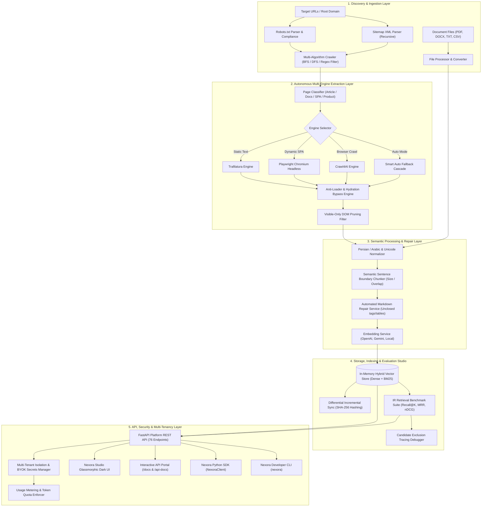

---

## 💻 Python SDK & Developer CLI

### Official Python SDK (`NexoraClient`)

Install the client library:

```bash
pip install nexora
```

Execute an end-to-end extraction, semantic chunking, and hybrid search workflow in Python:

```python
from nexora import NexoraClient

# 1. Initialize client with base URL and API key
client = NexoraClient(
    base_url="http://localhost:8000",
    api_key="your_workspace_or_admin_key"
)

# 2. Check platform readiness
health = client.health()
print(f"Status: {health['status']} | Active Jobs: {health['active_jobs_count']}")

# 3. Trigger autonomous website discovery
discovery_job = client.discovery.start(
    root_url="https://docs.example.com",
    max_depth=3,
    max_pages=50,
    keep_query_params=False
)
print(f"Started Discovery Job: {discovery_job.id}")

# 4. Extract structured markdown using Playwright Chromium
extract_job = client.extraction.start(
    urls=["https://docs.example.com/guide"],
    engine="playwright",
    crawl_mode="single"
)

# 5. Semantic sentence-boundary chunking
chunks = client.rag.chunk_text(
    text="# Enterprise RAG Ingestion\n\nNexora delivers high-precision grounding...",
    chunk_size=500,
    chunk_overlap=50
)
for chunk in chunks:
    print(f"Chunk {chunk.id}: {chunk.token_count} tokens")

# 6. Execute Hybrid Search (Dense + BM25 RRF)
matches = client.vector_store.search(
    query="autonomous web crawling and semantic chunking",
    top_k=5,
    hybrid=True
)
for match in matches:
    print(f"Score {match.score:.3f} | {match.text[:90]}...")
```

### Developer CLI (`nexora`)

Nexora includes a complete developer CLI for automation, cron jobs, and terminal workflows:

```bash
# Display help and available command groups
nexora --help

# 1. Autonomous Web Crawler
nexora crawl --url https://example.com --max-depth 3 --max-pages 100 --concurrency 5

# 2. 4-Engine Content Extraction
nexora extract --url https://example.com/article --engine playwright --output ./output.md

# 3. File Processing & Ingestion
nexora files process --path ./manual.pdf --chunk --embed

# 4. Information Retrieval Benchmarking
nexora eval run --dataset prod_benchmark_v1 --top-k 5

# 5. Hybrid Vector Store Search
nexora search --query "dynamic hydration bypass" --top-k 3 --hybrid
```

---

## 🛠️ Quickstart Guide

### Prerequisites
- **Python**: 3.10, 3.11, or 3.12
- **Git**
- **Operating System**: Linux, macOS, or Windows (Windows Proactor Event Loop supported out-of-the-box)

### Step 1: Clone the Repository

```bash
git clone https://github.com/your-username/nexora.git
cd nexora
```

### Step 2: Setup Virtual Environment

```bash
# Create virtual environment
python -m venv .venv

# Activate virtual environment
# Windows (PowerShell):
.venv\Scripts\Activate.ps1
# Linux / macOS:
source .venv/bin/activate
```

### Step 3: Install Dependencies & Headless Browsers

```bash
# Install core platform requirements
pip install -r requirements.txt

# Install Playwright Chromium headless browser binaries
playwright install chromium
```

### Step 4: Configure Environment Variables

```bash
# Copy template configuration
cp .env.example .env
```

Key environment configuration options in `.env`:

```ini
APP_ENV=development
HOST=127.0.0.1
PORT=8000
LOG_LEVEL=INFO

# Master Secret (leave blank for local open development)
API_KEY=cbk_master_secret_key

# Optional: AI Provider Keys for RAG and Vector Embeddings
OPENAI_API_KEY=sk-...
GEMINI_API_KEY=AIzaSy...
```

### Step 5: Launch Nexora Studio

```bash
python run.py
```

Access the platform:
- 🌐 **Nexora Studio UI**: [http://127.0.0.1:8000/](http://127.0.0.1:8000/)
- 📚 **Interactive API Portal**: [http://127.0.0.1:8000/docs](http://127.0.0.1:8000/docs)
- ⚙️ **OpenAPI JSON Spec**: [http://127.0.0.1:8000/openapi.json](http://127.0.0.1:8000/openapi.json)
- 🛠️ **Raw Swagger UI**: [http://127.0.0.1:8000/swagger](http://127.0.0.1:8000/swagger)

---

## 🧪 Rigorous Testing & Quality Assurance

Nexora enforces strict code quality with a comprehensive suite of **474 automated tests** covering anti-bot evasion, SSRF security, vector math, IR evaluation, and multi-tenant data isolation:

```bash
# Run the complete test suite
pytest -q
```

```
================= 480 passed, 7 warnings in 69.81s (0:01:09) ==================
```

<details>
<summary><b>🔍 Click to expand the 29 Test Modules Breakdown</b></summary>

| Test Suite Module | Focus Area | Status |
| :--- | :--- | :---: |
| `test_live_extraction.py` | Real-time watchers, state replacement, Turn ON/OFF | ✅ PASS |
| `test_phase1_antibot_core.py` | Anti-bot fingerprinting, anti-loader bypass | ✅ PASS |
| `test_phase1_security_hardening.py` | SSRF prevention, private IP blocking, DNS rebinding | ✅ PASS |
| `test_phase1_stabilization.py` | Concurrency limits, watchdog timeouts | ✅ PASS |
| `test_phase2_byok_security.py` | Customer secret encryption, BYOK credential rotation | ✅ PASS |
| `test_phase2_data_studio.py` | Stage inspection, chunk merging, splitting | ✅ PASS |
| `test_phase2_response_classification.py` | Page type classifier, HTML fallback router | ✅ PASS |
| `test_phase3_rag_evaluation.py` | Recall@K, MRR, nDCG metrics, comparative runs | ✅ PASS |
| `test_phase3_tenant_data_isolation.py` | Multi-tenant storage boundary enforcement | ✅ PASS |
| `test_phase4_developer_platform.py` | Incremental sync, API v1 routing, OpenAPI integrity | ✅ PASS |
| `test_phase4_usage_metering_and_quotas.py` | Token quotas, request rate limiting | ✅ PASS |
| `test_semantic_repair.py` | Markdown tag closing, table alignment repair | ✅ PASS |
| `test_multi_algorithm_discovery.py` | BFS vs DFS vs Sitemap crawler routing | ✅ PASS |
| `test_normalizer.py` | Persian/Arabic unicode normalization, half-spaces | ✅ PASS |
| `test_playwright_engine.py` | Chromium headless lifecycle, dynamic SPA wait | ✅ PASS |
| `test_rag_pipeline_and_deduplication.py` | Sentence chunking, SHA-256 deduplication | ✅ PASS |

</details>

---

## 🐳 Production Deployment (Docker & Systemd)

### Docker & Docker Compose

Deploy the complete Nexora platform using Docker:

```yaml
version: "3.9"

services:
  nexora:
    build: .
    container_name: nexora-studio
    restart: unless-stopped
    ports:
      - "8000:8000"
    environment:
      - APP_ENV=production
      - HOST=0.0.0.0
      - PORT=8000
      - API_KEY=${NEXORA_MASTER_SECRET}
    volumes:
      - ./data:/app/data
      - ./logs:/app/logs
```

```bash
# Build and run containers
docker compose up -d --build
```

### Linux Systemd Service

```ini
[Unit]
Description=Nexora Web Intelligence & RAG Platform
After=network.target

[Service]
Type=simple
User=nexora
WorkingDirectory=/opt/nexora
ExecStart=/opt/nexora/.venv/bin/python run.py
Restart=always
RestartSec=5
Environment=APP_ENV=production

[Install]
WantedBy=multi-user.target
```

---

## 🚀 Pushing to GitHub (Step-by-Step Guide)

To publish your Nexora repository to GitHub:

### 1. Stage Cleaned Files and Commit
All temporary files (`scratch/`, `data/`, `.env`) are automatically excluded by our `.gitignore`:

```bash
git add .
git commit -m "feat(nexora): launch Nexora Studio v5.0 with 4-engine crawler, IR evaluation, interactive API docs, and multi-tenant SDK"
```

### 2. Connect to your GitHub Repository
Create a new empty repository named `Nexora` on GitHub (without initializing README/license):

```bash
# Rename branch to main
git branch -M main

# Set remote origin URL (replace with your GitHub username)
git remote set-url origin https://github.com/<YOUR_USERNAME>/Nexora.git

# Push code to GitHub
git push -u origin main
```

---

## 🤝 Contributing

Contributions are welcomed! Please follow these guidelines:

1. Fork the Project on GitHub.
2. Create your Feature Branch (`git checkout -b feature/AmazingFeature`).
3. Verify test passing (`pytest -q`).
4. Commit your Changes (`git commit -m 'feat: add amazing feature'`).
5. Push to the Branch (`git push origin feature/AmazingFeature`).
6. Open a Pull Request.

---

## 📄 License

Distributed under the **MIT License**. See [`LICENSE`](LICENSE) for more information.

<div align="center">
  <sub>Built with ❤️ by the Nexora Intelligence Team. Engineered for production RAG & Agentic AI workflows.</sub>
</div>
