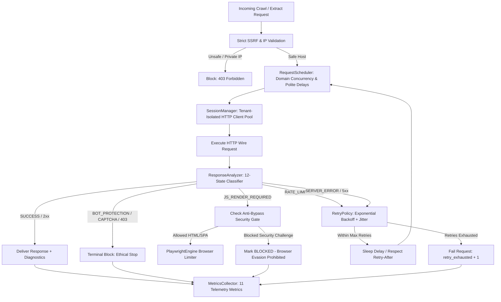

# Anti-Bot Detection, Request Scheduling & Resilience Subsystem

## 1. Executive Summary

Crawlbot features an enterprise-grade, ethical, and resilient request orchestration subsystem (`app.services.anti_bot`) designed for high-throughput web crawling, content extraction, and multi-tenant SaaS environments.

The subsystem replaces fragile, uncoordinated HTTP requests with a deterministic, rate-limiting, and diagnostic-driven architecture that complies with ethical web standards while defending against request exhaustion, rate limiting, and network instability.



---

## 2. Core Architectural Components

### 2.1 RequestScheduler (`app.services.anti_bot.RequestScheduler`)
- **Global Concurrency Throttling:** Enforces system-wide ceiling on simultaneous network connections (`max_global_concurrency`).
- **Per-Domain Concurrency Semaphores:** Isolates domain traffic so high-concurrency requests to one domain cannot starve other domains.
- **Polite Inter-Request Delays:** Guarantees minimum intervals (`min_delay_seconds`) between subsequent requests directed to the exact same host.
- **Cancellation Awareness:** Reacts immediately to job cancellation events (`asyncio.Event`) without hanging semaphores.

### 2.2 RetryPolicy (`app.services.anti_bot.RetryPolicy`)
- **Exponential Backoff with Full Jitter:** Computes retry delay using:
  $$\text{Delay} = \min(\text{max\_delay}, \text{base\_delay} \times 2^{\text{attempt}}) \times \text{uniform}(1 - \text{jitter}, 1 + \text{jitter})$$
- **RFC 7231 `Retry-After` Header Parsing:** Complies with HTTP `Retry-After` headers expressed either in delta seconds (e.g. `Retry-After: 120`) or HTTP IMF-fixdate format (e.g. `Retry-After: Wed, 21 Oct 2026 07:28:00 GMT`).
- **Retryability Discrimination:**
  - *Retryable:* Transient network timeouts (`httpx.TimeoutException`), connection resets (`httpx.ConnectError`), rate limits (429), and upstream server errors (500, 502, 503, 504).
  - *Non-Retryable:* Access denied (401, 403), permanent not found (404), client input errors (400, 422), and bot protection challenges.

### 2.3 ResponseAnalyzer (`app.services.anti_bot.ResponseAnalyzer`)
Categorizes any HTTP response or exception into one of **12 standardized classifications**:
1. `SUCCESS`: Valid 2xx response with parseable content.
2. `HTTP_FORBIDDEN`: Standard 403 Forbidden without bot challenge signals.
3. `BOT_PROTECTION`: WAF or CDN mitigation challenge (Cloudflare 1020, Akamai, PerimeterX, Datadome, AWS WAF).
4. `RATE_LIMITED`: 429 Too Many Requests or 503 with rate limit cues.
5. `ROBOTS_DENIED`: Blocked by site `robots.txt` directive or Disallow rule.
6. `CAPTCHA_REQUIRED`: reCAPTCHA, hCaptcha, Turnstile, or Arkose challenge form.
7. `JS_RENDER_REQUIRED`: Empty body shell, React/Vue/Angular mounting node, or `<noscript>` warning.
8. `AUTH_REQUIRED`: 401 Unauthorized or Basic/Bearer authentication required.
9. `NETWORK_ERROR`: DNS failure, connection refused, or SSL handshake error.
10. `TIMEOUT`: Read, write, or connect timeout.
11. `SERVER_ERROR`: 5xx internal server or gateway error.
12. `UNKNOWN_ERROR`: Unrecognized HTTP or parsing failure.

### 2.4 SessionManager (`app.services.anti_bot.SessionManager`)
- **Tenant-Isolated Client Pooling:** Maintains independent `httpx.AsyncClient` instances per `tenant_id`. Cookies, sessions, and headers never leak across workspace boundaries.
- **Connection Reuse:** Uses HTTP keep-alive connection pooling to eliminate TCP handshake and TLS negotiation overhead.
- **Graceful Lifecycle Management:** Explicit cleanup via `close_client(tenant_id)` and `close_all()` on server shutdown or job termination.

### 2.5 DomainPolicyManager (`app.services.anti_bot.DomainPolicyManager`)
- Stores custom per-domain configuration rules (maximum concurrency, crawl delay, request timeout, maximum retries).
- Dynamically updates crawl delays upon parsing `Crawl-delay` directives in `robots.txt`.

### 2.6 MetricsCollector (`app.services.anti_bot.MetricsCollector`)
- Thread-safe telemetry engine tracking request health without external dependencies.
- **Per-Job & Global Rollups:** Metrics can be queried for a single `job_id` or aggregated globally across the entire node.
- **Bounded Cardinality:** Metric labels are strictly constrained to the 12 `ResponseClassification` states to guarantee zero memory growth or label explosion.

---

## 3. Strict Ethical Crawling & Anti-Bypass Security Gate

Crawlbot strictly adheres to ethical crawler policies. The system does not attempt to circumvent website access controls:

| Mechanism | Crawler Behavior |
|---|---|
| **CAPTCHA Challenges** | **Never solved or bypassed.** Marked `QualityStatus.BLOCKED` with classification `CAPTCHA_REQUIRED`. |
| **Bot Shields & WAFs** | **Never evaded with rotating proxies.** Terminated immediately and recorded as `BOT_PROTECTION`. |
| **Browser Fallback Gate** | If HTTP diagnostics indicate `BOT_PROTECTION`, `CAPTCHA_REQUIRED`, `HTTP_FORBIDDEN`, or `AUTH_REQUIRED`, promotion to Playwright/Crawl4AI is **strictly blocked** to prevent evasion attempts. |
| **User-Agent Header** | Clear, standard, and identifiable User-Agent (`Crawlbot/1.0 (+https://github.com/crawlbot)`). No spoofing of random browser fingerprints. |
| **Robots.txt** | Parsed and respected prior to fetching page URLs. Disallowed URLs are immediately flagged `BLOCKED`. |

---

## 4. Subsystem Telemetry (11 Core Metrics)

Every HTTP request executed by `AntiBotManager`, `CrawlerService`, and `ContentExtractor` updates the following telemetry model:

```json
{
  "requests_total": 150,
  "successful_requests": 142,
  "failed_requests": 8,
  "blocked_requests": 3,
  "rate_limited_requests": 2,
  "retry_attempts": 5,
  "retry_exhausted": 1,
  "timeout_count": 2,
  "average_request_latency": 0.2845,
  "browser_fallback_count": 4,
  "classification_count": {
    "SUCCESS": 142,
    "HTTP_FORBIDDEN": 1,
    "BOT_PROTECTION": 1,
    "RATE_LIMITED": 2,
    "ROBOTS_DENIED": 1,
    "CAPTCHA_REQUIRED": 0,
    "JS_RENDER_REQUIRED": 4,
    "AUTH_REQUIRED": 0,
    "NETWORK_ERROR": 1,
    "TIMEOUT": 2,
    "SERVER_ERROR": 1,
    "UNKNOWN_ERROR": 0
  }
}
```

### Telemetry Availability Points
1. **Per-Job API Responses:**
   - `GET /api/discovery/status/{job_id}`: Included in the `JobStatus.metrics` field.
   - `GET /api/extraction/status/{job_id}`: Included in the `JobStatus.metrics` field.
   - `GET /api/jobs/{job_id}`: Included in the `JobStatus.metrics` field.
2. **Global System Health:**
   - `GET /api/admin/health`: Included under the `antibot_metrics` key (requires Master Admin API Key).

---

## 5. Security & Resource Controls

### 5.1 SSRF Defenses & Redirect Validation
- Every target URL is validated via `validate_url_safety()` before sending an HTTP request.
- DNS resolution checks verify that the host does not resolve to private, loopback, link-local, multicast, or cloud metadata IP addresses (`127.0.0.0/8`, `10.0.0.0/8`, `172.16.0.0/12`, `192.168.0.0/16`, `169.254.169.254`, `::1`).
- **Hop-by-Hop Re-Validation:** On every redirect (301, 302, 303, 307, 308), the destination URL in the `Location` header is normalized and completely re-validated against SSRF policies before following.
- Redirect loops and cycles are tracked using visited URL sets and limited to a maximum of 5 hops.

### 5.2 Header Sanitization & Privacy
- Diagnostics models and structured logs scrub all credentials, sessions, cookies, and bearer tokens using `sanitize_headers()` before persistence or API emission.
- Sensitive header keys filtered: `authorization`, `cookie`, `set-cookie`, `proxy-authorization`, `x-api-key`, `api-key`, `token`, `x-auth-token`, `bearer`, `password`, `x-admin-secret`, `session`.

### 5.3 Memory & Stream Protections
- Inbound response streams in `CrawlerService` read byte chunks incrementally and terminate reading immediately if `max_response_size` (default 10 MB) is exceeded.
- Diagnostic response body inspection (`ResponseAnalyzer.MAX_SNIPPET_BYTES`) is capped at 64 KB to eliminate buffer bloat.

### 5.4 Playwright Concurrency Guards
- Headless Chromium instances are throttled by `BrowserConcurrencyLimiter` (default maximum of 2 concurrent browser contexts).
- Strict `finally:` cleanup ensures browser pages, browser contexts, and browser processes are unconditionally closed upon completion, timeout, or cancellation.

---

## 6. Code Examples & Usage

### Basic Usage
```python
from app.services.anti_bot import get_antibot_manager, ResponseClassification

antibot = get_antibot_manager()

# Resilient fetch with SSRF check, polite delay, and automatic retries
response, diag = await antibot.fetch(
    url="https://example.com/api/data",
    job_id="job-uuid-1234",
    tenant_id="tenant-alpha",
)

if diag.classification == ResponseClassification.SUCCESS:
    print(f"Fetched {len(response.text)} characters")
elif diag.classification == ResponseClassification.RATE_LIMITED:
    print(f"Encountered rate limit: {diag.reason}")
elif not diag.retryable:
    print(f"Terminal access error: {diag.classification.value} - {diag.reason}")
```

### Inspecting Metrics
```python
# Query metrics for a specific job
job_metrics = antibot.metrics.get_metrics("job-uuid-1234")
print(f"Total requests: {job_metrics['requests_total']}")
print(f"Average latency: {job_metrics['average_request_latency']}s")

# Query global system metrics
global_metrics = antibot.metrics.get_metrics()
print(f"System-wide retries exhausted: {global_metrics['retry_exhausted']}")
```
