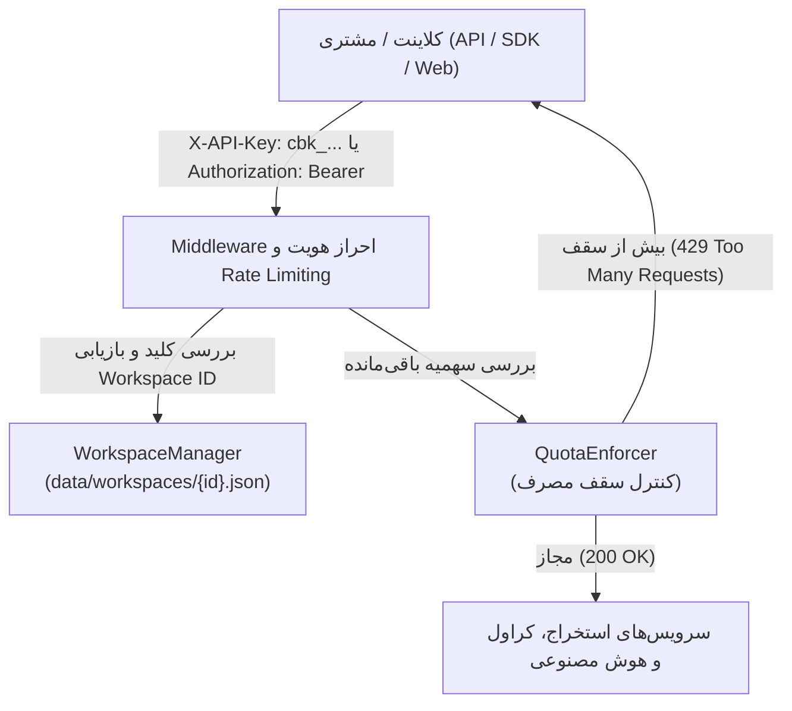

# راهنمای جامع عملیات، مدیریت چندمستاجره (SaaS) و سهمیه‌بندی Crawlbot Studio

این سند، راهنمای فنی، عملیاتی و معماری پلتفرم تجاری و چندمستاجره (Multi-Tenant SaaS) در Crawlbot Studio است. این معماری به تیم‌های محصول و مهندسی اجازه می‌دهد بدون نیاز به دیتابیس‌های سنگین و زیرساخت‌های پیچیده ابری، سرویس Crawlbot را به عنوان یک پلتفرم چندمشتریه (Multi-Tenant) پایدار، ایزوله و قابل‌اتکا عرضه نمایند.

---

## ۱. معماری فضاهای کاری و احراز هویت (Workspace & Authentication)



### ۱.۱. مدل فضای کاری (Workspace)
هر مشتری یا پروژه به عنوان یک `Workspace` مجزا با شناسه پایدار `UUID` تعریف می‌شود.
اطلاعات فضای کاری در مسیر `data/workspaces/{workspace_id}.json` به صورت پایدار و مستقل نگهداری می‌گردد:

```json
{
  "workspace_id": "c7a8b921-4d32-4912-9c1a-8e2b3c4d5e6f",
  "name": "تیم هوش مصنوعی شرکت آلفا",
  "plan": "developer",
  "description": "پایپ‌لاین RAG و استخراج اسناد دانشنامه‌ای",
  "_api_key_raw": "cbk_...",
  "created_at": "2026-10-30T08:00:00Z",
  "updated_at": "2026-10-30T08:00:00Z"
}
```

### ۱.۲. مدیریت کلیدهای API (API Key Lifecycle)
- **پیشوند امن:** کلیه کلیدهای فضای کاری با پیشوند `cbk_` و رشته ۳۲ بایتی امن تصادفی (تولیدشده با `secrets.token_urlsafe`) ایجاد می‌شوند.
- **اصل نمایش یک‌باره (One-time Display):** کلید خام تنها در پاسخ درخواست ساخت (`POST /api/workspaces/`) یا بازتولید (`POST /api/workspaces/{id}/rotate-key`) بازگردانده می‌شود.
- **ماسک کردن در کلیه APIها:** در کلیه اندپوینت‌های گزارش‌گیری و نمایش مشخصات، صرفاً پیشوند ۸ کاراکتری کلید بازگردانده می‌شود (`cbk_a1b2...`) و کلید کامل هرگز در پاسخ‌های دیگر یا لاگ‌ها چاپ نمی‌گردد.

---

## ۲. ایزوله‌سازی کامل داده‌ها (Multi-Tenancy & Data Isolation)

تمامی عملیات ذخیره‌سازی، خواندن، دانلود و حذف در هسته برنامه بر اساس `tenant_id` اعتبارسنجی می‌شوند:

| نوع داده | مسیر و سازوکار ایزوله‌سازی | سیاست دسترسی متقابل |
| :--- | :--- | :--- |
| **Jobها و وظایف کراول** | متغیر `tenant_id` در `JobInfo` و دیسک `data/jobs/{tenant_id}/{job_id}.json` | مستاجر B امکان مشاهده یا لغو کارهای مستاجر A را ندارد (HTTP 404). |
| **اسناد و چانک‌ها** | حافظه و دیسک بر اساس مالکیت جاب | دسترسی صرفاً از طریق جاب مجاز است. |
| **خروجی‌ها (Exports)** | مسیرهای `output/{tenant_id}/{job_id}/` | اندپوینت `/api/export/download` مالکیت جاب را بررسی و در صورت عدم تطابق 404 برمی‌گرداند. |
| **مانیفست افزایشی** | فایل‌های مانیفست در `data/manifests/{tenant_id}/` | جداسازی وضعیت صفحات و هش‌ها برای هر مستاجر. |
| **کلیدهای هوش مصنوعی (BYOK)** | مسیر `data/secrets/{tenant_id}.json` رمزنگاری‌شده | غیرقابل دسترسی از سوی سایر فضاها. |
| **گزارش‌های مصرف** | مسیر `data/usage/{tenant_id}/{YYYY-MM}.jsonl` | ایزوله در دایرکتوری اختصاصی هر مستاجر. |

---

## ۳. سیستم سنجش و اندازه‌گیری مصرف (Usage Metering)

سرویس `UsageMeter` کلیه مصرف واقعی منابع را به صورت رویدادمحور (Event-Driven) در لاگ‌های ساختاریافته ماهانه ذخیره می‌کند:
- **مسیر ذخیره رویدادها:** `data/usage/{workspace_id}/{YYYY-MM}.jsonl`
- **فرمت رویداد:** هر سطر یک سند JSON استاندارد:
```json
{
  "workspace_id": "c7a8b921-...",
  "event_type": "pages_crawled",
  "quantity": 15.0,
  "job_id": "job-9988",
  "metadata": {"root_url": "https://example.com"},
  "recorded_at": "2026-10-30T08:15:30Z"
}
```

### واحدهای سنجش و شاخص‌های مصرف:
1. `pages_crawled`: تعداد صفحات کراول‌شده و استخراج‌شده (مجموع صفحات وب).
2. `files_processed`: تعداد فایل‌های محلی آپلود و پردازش‌شده (PDF/DOCX/Markdown).
3. `chunks_created`: تعداد چانک‌های متنی تولیدشده جهت استفاده در RAG.
4. `embeddings_generated`: تعداد بردارهای امبدینگ تولیدشده.
5. `llm_tokens`: تعداد توکن‌های ارسال و دریافت شده در پردازش‌های LLM (در صورت فعال‌بودن).
6. `storage_bytes`: حجم بایت‌های خروجی و فایل‌های ذخیره‌شده.
7. `job_count`: تعداد وظایف پس‌زمینه ایجادشده.

---

## ۴. کنترل سهمیه، پلن‌ها و محدودیت نرخ (Quota & Rate Limiting)

### ۴.۱. پیکربندی پلن‌ها (`data/plans.json`)
پلن‌ها در قالب فایل مستقل و بدون هاردکد در سورس‌کد تنظیم می‌شوند:

| شاخص سهمیه | پلن آزمایشی (Trial) | پلن توسعه‌دهنده (Developer) | پلن حرفه‌ای (Professional) |
| :--- | :--- | :--- | :--- |
| **سقف صفحات در ماه** | ۱۰۰ صفحه | ۲,۰۰۰ صفحه | ۲۰,۰۰۰ صفحه |
| **حداکثر حجم فایل** | ۵ مگابایت | ۲۵ مگابایت | ۱۰۰ مگابایت |
| **کارهای همزمان** | ۱ جاب | ۳ جاب | ۱۰ جاب |
| **سقف چانک در ماه** | ۵,۰۰۰ چانک | ۱۰۰,۰۰۰ چانک | ۱,۰۰۰,۰۰۰ چانک |
| **امبدینگ برداری** | ۲,۰۰۰ بردار | ۵۰,۰۰۰ بردار | ۵۰۰,۰۰۰ بردار |
| **نگهداری تاریخچه** | ۷ روز | ۳۰ روز | ۹۰ روز |
| **پشتیبانی از BYOK** | غیرفعال | فعال | فعال |

### ۴.۲. رفتار سیستم در برخورد با محدودیت‌ها
- **سقف‌های نرم (Soft Limit - ۸۰٪):** سیستم در گزارش وضعیت سهمیه فیلد `near_limit` را پر کرده و اخطار می‌دهد.
- **سقف‌های سخت (Hard Limit):** در صورت اقدام به ایجاد وظیفه فراتر از سقف مجاز، سامانه خطای ساختاریافته استاندارد `429 Too Many Requests` به همراه پیام شفاف به زبان فارسی صادر می‌کند.
- **محدودیت نرخ درخواست‌ها (Rate Limiting):** الگوریتم پنجره لغزنده (Sliding Window) در سطح شبکه از سوءاستفاده و بارگذاری بیش از حد سرور جلوگیری می‌کند.

---

## ۵. امنیت کلیدهای مشتری و مدل BYOK (Bring Your Own Key)

سرویس `SecretsManager` امکان اتصال کلید اختصاصی OpenAI یا سایر سرویس‌ها توسط هر مشتری را فراهم می‌سازد:
- **رمزنگاری متقارن نظامی (AES Fernet):** کلیدها به صورت رمزشده با کلید مستر در دیسک ذخیره می‌شوند (`data/secrets/{workspace_id}.json`).
- **کلید مستر رمزنگاری:** از متغیر محیطی `CRAWLBOT_SECRET_KEY` دریافت شده یا در صورت نبود، به صورت امن در دایرکتوری حفاظت‌شده سیستم تولید می‌شود.
- **عدم نشت اطلاعات:** کلیدها هرگز در لاگ‌ها، کنسول یا اندپوینت‌های عمومی فرانت‌اند نمایش داده نمی‌شوند و در API فقط به صورت ماسک‌شده (`sk-p**********************1234`) گزارش می‌شوند.

---

## ۶. پایداری وظایف پس‌زمینه و سرویس نگهبان (Job Watchdog)

برای تضمین این که سرور با کارهای معلق یا قطع ناگهانی آسیب نمی‌بیند:
1. **پایداری وضعیت روی دیسک (Crash Recovery):** وضعیت هر وظیفه علاوه بر رم، در `data/jobs/{tenant_id}/{job_id}.json` ثبت می‌شود تا پس از ری‌استارت سرور قابل بازیابی باشد.
2. **شناسایی جاب‌های گیرکرده (Stuck Jobs):** اگر جابی بیش از `max_job_runtime_minutes` در حالت `RUNNING` باقی بماند، به صورت خودکار توسط نگهبان لغو و علت در گزارش خطا ثبت می‌شود.
3. **پاکسازی زمان‌بندی‌شده آرتیفکت‌ها:** اندپوینت عملیاتی `/api/admin/cleanup` فایل‌های خروجی منقضی‌تر از دوره نگهداری پلن (مثلاً بیش از ۳۰ روز) را به صورت خودکار پاکسازی می‌نماید.

---

## ۷. اندپوینت‌های مدیریتی و عملیاتی (Admin & Maintenance API)

| متد | مسیر (Endpoint) | کاربرد و توضیحات |
| :--- | :--- | :--- |
| `GET` | `/api/admin/health` | گزارش سلامت کلی سرور، وضعیت رم، تعداد کل کارهای فعال و حجم مصرفی دیسک |
| `GET` | `/api/admin/usage-summary` | گزارش جدول تجمیعی مصرف ماهانه تمامی فضاهای کاری |
| `POST` | `/api/admin/cleanup` | اجرای پاکسازی فیزیکی دایرکتوری‌های خروجی منقضی |
| `GET` | `/api/admin/watchdog/status` | وضعیت پیکربندی سرویس نگهبان وظایف پس‌زمینه |
| `POST` | `/api/admin/watchdog/run` | اسکن و ابطال دستی وظایف قفل‌شده |
| `POST` | `/api/workspaces/` | ایجاد فضای کاری جدید به همراه کلید اختصاصی |
| `GET` | `/api/workspaces/{id}/quota` | استعلام زنده وضعیت مصرف و سهمیه باقی‌مانده |
| `POST` | `/api/workspaces/{id}/secrets` | ذخیره امن کلید اختصاصی هوش مصنوعی مشتری (BYOK) |

---

## ۸. دستورالعمل پشتیبان‌گیری و بازیابی (Backup & Disaster Recovery)

### ۸.۱. فایل‌های حیاتی برای پشتیبان‌گیری:
برای تهیه پشتیبان کامل از کلیه داده‌های مستاجران، کافی است پوشه‌های زیر را ذخیره فرمایید:
```bash
# پشتیبان‌گیری از فضاهای کاری، سهمیه‌ها و مصرف
tar -czvf crawlbot_backup_$(date +%Y%m%d).tar.gz data/ output/ .env
```

### ۸.۲. بازیابی سرویس (Restore):
```bash
# استخراج نسخه پشتیبان روی سرور جدید
tar -xzvf crawlbot_backup_20261030.tar.gz
# اجرای سرویس با پایتون ۳.۱۰+
python run.py
```
سرویس به صورت خودکار ایندکس کلیدها، مانیفست‌ها و پایپ‌لاین‌های آماده را از روی دیسک بازخوانی و فعال می‌نماید.
